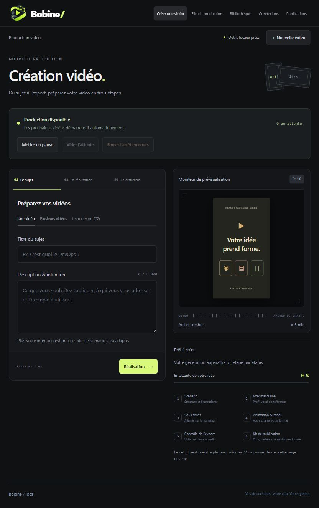
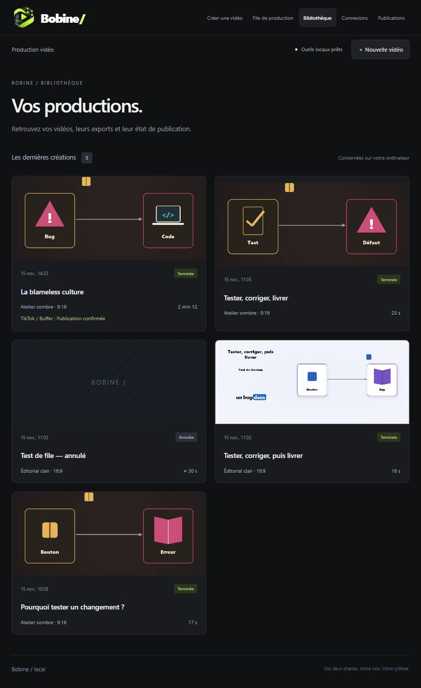
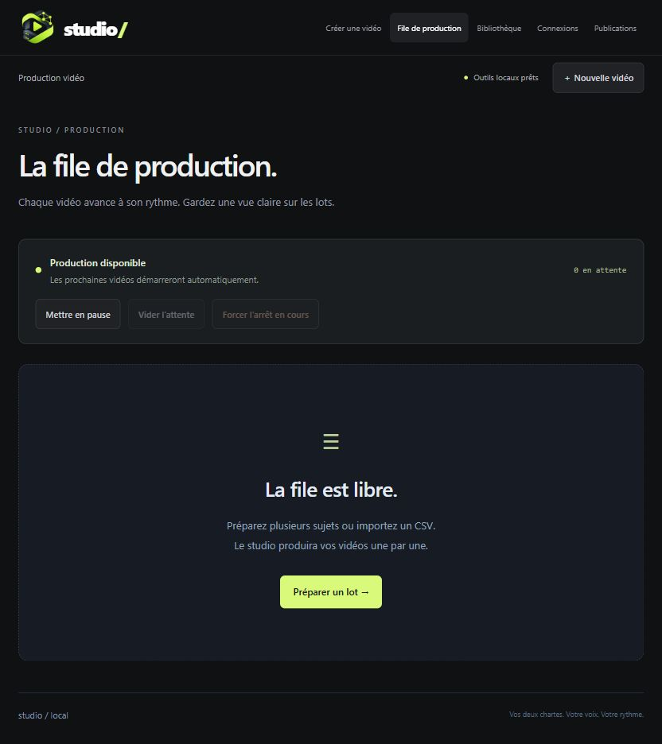
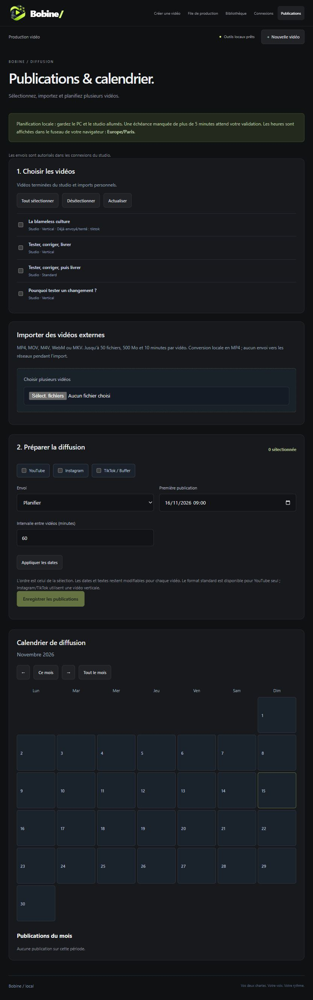

<p align="center"></p>

# Bobine

**Vos idées prennent vie, image après image.**

[](LICENSE) [](https://github.com/DavyLss/bobine/actions/workflows/check.yml)

Studio vidéo pédagogique en français, exécuté sur le poste : scénario IA, voix masculine de référence, sous-titres synchronisés et animations. Interface simple : titre, description, charte, durée moyenne, format, puis génération avec suivi et historique.

Deux directions conservées : **Atelier sombre** et **Éditorial clair**, avec apparitions, rebonds, objets et typographie. La dernière charte utilisée est mémorisée. Formats **Reel 1080 × 1920** et **Standard 1920 × 1080**, 30 images/s, MP4 H.264/AAC.

## Aperçu du studio

Captures de l’interface actualisées le 15 novembre 2026.

**Création en trois étapes** : sujet, réalisation et diffusion, avec moniteur de prévisualisation.



<details>
<summary>Voir la bibliothèque et les commandes de production</summary>

**Bibliothèque** : miniatures des vidéos, paramètres et état de publication.



**File de production** : pause, reprise, suppression de l’attente et arrêt forcé. Les commandes sans tâche correspondante sont désactivées.



</details>

## Installation Windows

Prérequis : [Python 3.11 64 bits](https://www.python.org/downloads/), [Git](https://git-scm.com/downloads) et [Ollama](https://ollama.com/download). Lancer Ollama avant l'installation. Prévoir plusieurs gigaoctets de téléchargements et de stockage ; 16 Go de RAM minimum conseillé, 32 Go préférable. La voix fonctionne sur CPU et peut prendre plusieurs minutes par vidéo. Un GPU NVIDIA compatible accélère le rendu ; le CPU est utilisé automatiquement si NVENC est indisponible.

```powershell
git clone https://github.com/DavyLss/bobine.git
cd bobine
.\Installer.ps1
.\Lancer-Studio.ps1
```

Ouvrir **http://127.0.0.1:8510/**. Si PowerShell bloque les scripts, ne pas modifier sa politique sans comprendre la règle du poste : les commandes Python équivalentes sont dans [INSTALLATION.md](docs/INSTALLATION.md).

`Installer.ps1 -SkipModels` installe seulement les dépendances. `Installer.ps1 -Python 'C:/chemin/python.exe'` sélectionne explicitement un Python 3.11. Les deux environnements Python isolent les dépendances du studio et celles de Qwen.

## Utilisation

1. Donner un titre et une description précise du public, du sujet et de l'exemple souhaité.
2. Choisir une charte, la durée cible (15 à 180 secondes), puis Standard ou Reel.
3. Lancer et suivre scénario → voix → synchronisation → rendu → vérification.
4. Relire et écouter avant publication. Télécharger la vidéo, le scénario et les sous-titres depuis l'interface.

### Générer plusieurs vidéos en séquence

Choisir **Plusieurs vidéos** pour saisir jusqu'à 50 titres/descriptions, ajouter ou retirer des lignes et changer leur ordre. La charte, la durée moyenne, le format et la voix sont communs à tout le lot.

Choisir **Importer un CSV** pour charger un fichier UTF-8, puis **Vérifier le fichier**. L'aperçu affiche les valeurs qui seront réellement utilisées. Télécharger le modèle dans l'interface ou partir de [cet exemple](examples/lot-devops.csv).

Colonnes : `titre, description, charte, duree, format, voix` (les noms anglais `title, description, theme, duration, format, voice` sont aussi acceptés). Seuls titre et description sont obligatoires. Une cellule de réglage vide reprend la valeur commune ; une cellule remplie remplace cette valeur pour la ligne. Séparateurs acceptés : virgule, point-virgule et tabulation. Encadrer de guillemets les descriptions contenant le séparateur ou des retours à la ligne.

Valeurs : charte `dark`/`light` (ou `sombre`/`clair`), durée entière de 15 à 180 secondes, format `reel`/`standard` (ou `9:16`/`16:9`), voix `Narrateur-Homme-01`. Une seule voix est actuellement installée. Les fichiers sont limités à 1 Mo et 50 vidéos ; toute erreur bloque le lot avant sa mise en file, sans génération partielle.

Le panneau **Suivi des lots** affiche les vidéos dans l'ordre, l'étape courante, la progression globale, les succès, échecs et annulations, puis les liens de téléchargement. Le suivi automatique peut être désactivé pour consulter une autre vidéo. Tous les lots partagent la même file FIFO et **une seule vidéo est calculée à la fois** (100 vidéos actives/en attente au maximum).

Un échec laisse les vidéos suivantes continuer. **Annuler les vidéos en attente** laisse celle en cours se terminer. **Relancer les échecs** crée un nouveau lot pour les seules vidéos échouées ou interrompues. Fermer la page ne coupe pas la génération tant que le serveur fonctionne. La barre de production permet de **mettre en pause après la vidéo en cours**, puis de reprendre plus tard. La pause et les vidéos en attente sont conservées après un redémarrage du studio. Seule une vidéo dont le rendu était en cours au moment de l’arrêt est marquée interrompue et doit être relancée ; aucun rendu ne reprend au milieu de son calcul.

Dans **File de production**, vous pouvez retirer une seule vidéo en attente ou **vider toute l’attente** sans arrêter celle en cours. **Forcer l’arrêt en cours** termine le processus de rendu et ses sous-processus, puis laisse la file en pause pour décider de la suite. Les fichiers locaux sont conservés, et les vidéos retirées restent visibles comme annulées dans l’historique. La pause concerne la génération ; les publications déjà engagées conservent leur suivi.

La durée est une cible : la voix garde son rythme et ses pauses. Le moteur sélectionne huit compositions animées ; il ne génère pas librement des personnages 3D ni une mise en scène originale complète pour chaque sujet. Les modèles peuvent produire des erreurs et des variations de voix malgré la référence fixe.

## Publications en masse et calendrier

L’onglet **Publications** permet de choisir jusqu’à 50 vidéos terminées ou d’importer plusieurs fichiers externes (MP4, MOV, M4V, WebM, MKV ; 500 Mo et 10 minutes maximum par fichier). Les imports sont convertis localement, puis leurs textes restent à compléter avant diffusion.

Choisir les réseaux communs, préparer les textes par vidéo et publier en séquence ou répartir les dates à partir d’une première échéance et d’un intervalle. Le calendrier mensuel permet de consulter les statuts, déplacer une date et annuler un plan encore en attente.

**Planification locale : le PC et le studio doivent rester allumés.** Une échéance manquée demande une reprogrammation ; les vidéos ne sont pas renvoyées automatiquement en cas de résultat incertain. Voir [le guide de planification](docs/PLANIFICATION.md).

<details>
<summary>Voir l’espace Publications et son calendrier</summary>



</details>

## Stack incluse

| Étape | Outil local |
| --- | --- |
| Interface et orchestration | FastAPI, HTML/CSS/JavaScript sans compilation |
| Scénario structuré | Ollama + Qwen3 4B |
| Voix masculine fixe | Qwen3-TTS 1.7B Base + référence synthétique fournie |
| Contrôle du texte et alignement | faster-whisper Base |
| Animation et export | Pillow, NumPy, MoviePy, FFmpeg, NVENC ou libx264 |

Le téléchargement initial nécessite Internet ; la génération de la vidéo et du kit de publication reste locale. Ollama et les modèles doivent être présents sur le poste. La diffusion est facultative : elle envoie les fichiers aux réseaux configurés et, pour Instagram/TikTok, à l'hébergement média Cloudinary.

## Publication automatique des Reels

Le studio peut publier sur **YouTube via son API native**, **Instagram via son API native** et **TikTok via Buffer**. Les connexions se règlent dans l'interface, avec une notice et les liens de création des accès pour chaque API. Voir [PUBLICATION.md](docs/PUBLICATION.md).

Pour chaque nouvelle vidéo, Ollama prépare localement le titre, la description et les hashtags. Pillow génère une miniature verticale et une miniature YouTube selon la charte ; elles restent éditables et téléchargeables. Le JPG est envoyé directement à YouTube et fourni comme couverture à Instagram. Buffer ne transmettant pas de miniature JPEG, une copie TikTok peut inclure la couverture générée pendant les 0,6 premières secondes, sans changer l'export original.

Les envois sont désactivés par défaut. Après configuration, cocher les réseaux et **Publier automatiquement les Reels terminés** pour une vidéo ou un lot. Les vidéos existantes disposent d'un bouton de préparation du kit et d'un envoi manuel. Le suivi conserve un reçu par réseau et distingue réception, traitement et publication confirmée. Les résultats incertains ne sont pas renvoyés aveuglément.

Les API YouTube et Instagram ne nécessitent pas d'abonnement de publication ; leurs quotas, comptes et autorisations restent applicables. Buffer et Cloudinary ont leurs propres offres et limites. Aucun achat n'est déclenché par le studio. Les accès de l'utilisateur sont indispensables pour une publication réelle ; les tests automatisés utilisent des services simulés.

Les poids volumineux sont téléchargés depuis leurs sources officielles, avec révisions fixées dans [models.json](models.json). Le tag Ollama peut évoluer : son empreinte observée est indiquée dans le manifeste. Les coûts éventuels de génération sont ceux du matériel et de l’électricité ; aucune clé API de publication n’est nécessaire pour générer localement.

Les dépendances du studio sont contraintes par `requirements-lock.txt`, issu d'une installation Windows propre. Les principales versions de l'environnement voix sont fixées séparément ; ses dépendances transitives ne sont pas intégralement verrouillées.

## Organisation

- `studio/` : serveur, orchestration, synthèse et moteur d'animation.
- `assets/voice/` : référence masculine **synthétique**, texte et profil ; aucun enregistrement personnel.
- `docs/chartes/` : les deux chartes et règles d'apparition réutilisables.
- `examples/` : descriptions prêtes à soumettre et sources des épisodes précédents.
- `scripts/` : téléchargement des modèles et lancement d'un exemple via l'API locale.
- `.local/` : modèles téléchargés, préférences, historiques, médias et journaux, ignorés par Git.

Les sources historiques personnalisées dans `examples/sources/` documentent les mises en scène d'origine. Elles nécessitent leurs médias et alignements régénérés et ne sont pas le point d'entrée du studio portable. Voir [les exemples](examples/README.md).

Pour réutiliser des modèles déjà installés, définir `STUDIO_MODELS_DIR` vers le dossier contenant `Qwen3-TTS-1.7B-Base/` et `whisper-base/`. `STUDIO_VOICE_PYTHON` peut désigner un environnement Qwen existant. Voir [.env.example](.env.example) pour tous les réglages. Ce fichier n'est pas chargé automatiquement.

Les mêmes réglages peuvent être conservés dans `.local/config.json` (clés `STUDIO_PORT`, `STUDIO_MODELS_DIR`, etc.). Les variables d'environnement ont priorité. Ce fichier propre au poste est ignoré par Git ; il ne migre pas les chemins d'une machine vers une autre.

## Vérification

```powershell
.venv/Scripts/python.exe scripts/check.py
.venv/Scripts/python.exe -m pip install -r requirements-test.txt -c requirements-lock.txt
.venv/Scripts/python.exe scripts/check_api.py
.venv/Scripts/python.exe scripts/check_batches.py
.venv/Scripts/python.exe scripts/check_social.py
```

Le contrôle hors ligne vérifie l'intégrité du profil vocal, les 32 combinaisons de rendu (8 compositions × 2 chartes × 2 formats), la configuration et un export court CPU. Il ne télécharge pas les modèles et ne certifie pas la qualité d'une nouvelle narration. [État des validations](docs/VALIDATION.md).

Les tests de lots utilisent de vrais sous-processus de simulation pour vérifier l'ordre et la reprise après échec, sans lancer les modèles IA. Les tests DOM de l'interface sont facultatifs pour le développement : Node.js 24.15+ (branche 24), `npm ci`, puis `npm test`. Node.js n'est pas requis pour utiliser le studio.

Le serveur écoute exclusivement sur localhost. Ne pas l'exposer directement à Internet. Les fichiers de travail ne sont pas sauvegardés sur GitHub : sauvegarder séparément `.local/` si nécessaire.

## Composants externes

[ComfyUI](https://github.com/comfyanonymous/ComfyUI), [Wan2.2](https://github.com/Wan-Video/Wan2.2) et [MoneyPrinterTurbo](https://github.com/harry0703/MoneyPrinterTurbo) faisaient partie des expérimentations précédentes. Le studio actuel n'en dépend pas ; leurs sources et modèles ne sont pas recopiés. Voir [la stack optionnelle](docs/STACK-OPTIONNELLE.md).

Les logiciels, poids et polices gardent leurs licences propres : [notices](THIRD_PARTY_NOTICES.md). Le code spécifique au projet, les chartes, les exemples et la référence vocale synthétique fournie sont partagés sous [licence MIT](LICENSE), dans la mesure des droits du mainteneur. Les bibliothèques, modèles, codecs et autres composants tiers conservent leurs licences propres. La voix de référence est réutilisable et n’est pas exclusive. Voir [sa notice](assets/voice/README.md).

## Contribuer et signaler un problème

Consulter [CONTRIBUTING.md](CONTRIBUTING.md) pour l’environnement de développement et les tests, [CODE_OF_CONDUCT.md](CODE_OF_CONDUCT.md) pour les échanges et [SECURITY.md](SECURITY.md) pour les signalements confidentiels. Le projet est fourni sans garantie ni support contractuel.

## Fenêtre dédiée et raccourci Windows

L’installation crée un raccourci **Bobine** sur le Bureau de l’utilisateur, avec le logo de l’application. Le raccourci démarre le serveur local puis ouvre une fenêtre dédiée, sans onglets ni barre d’adresse, grâce au mode application d’Edge, Chrome ou Brave déjà installé. Aucun compte ni service distant n’est nécessaire pour cette fenêtre.

Pour créer le raccourci sur une installation existante :

```powershell
.\Creer-Raccourci.ps1
```

`Lancer-Studio.ps1` utilise aussi cette fenêtre par défaut. L’option `-Navigateur` conserve l’ouverture dans le navigateur habituel. Le profil de la fenêtre est séparé dans `.local/app-profile/`, ignoré par Git. Fermer la fenêtre ne coupe pas le serveur : les générations et publications planifiées peuvent continuer tant que le PC reste allumé.

Si le dossier du projet est déplacé, relancer `Creer-Raccourci.ps1` pour actualiser le raccourci.
